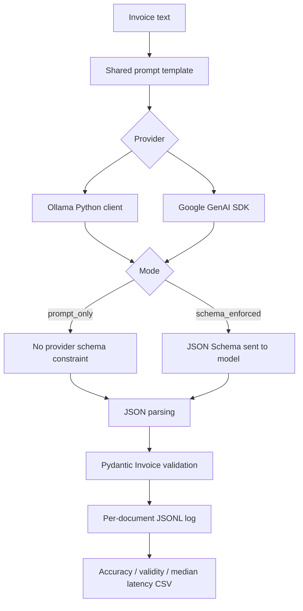

# Invoice Extractor

A reproducible benchmark for extracting four normalized fields from plain-text Arabic and English invoices. The project follows `SPEC.md`: all four output keys are required, leading zeroes are preserved, dates are ISO `YYYY-MM-DD` or `null`, amounts are JSON numbers or `null`, and currency is a three-letter ISO code or `null` when absent/ambiguous.

> Input is invoice text only. PDF/image OCR is outside this project’s scope.

## Architecture



The exact same prompt template is used for all providers and modes. `temperature=0` is used everywhere. The only mode difference is whether the provider receives the output schema. Every successful parsed output is validated using Pydantic; invalid JSON or invalid fields count as invalid in evaluation.

## Requirements

- Python 3.11+ recommended.
- Ollama installed and running locally, with the selected models already pulled.
- Gemini access requires `GEMINI_API_KEY` in the environment. The key is never hardcoded and is not loaded from `.env` by the app.
- `google-genai` is the official Google GenAI Python SDK.

## Install

### Windows PowerShell
```powershell
py -m venv .venv
.\.venv\Scripts\Activate.ps1
python -m pip install --upgrade pip
pip install -r requirements.txt
```

### macOS / Linux
```bash
python3 -m venv .venv
source .venv/bin/activate
python -m pip install --upgrade pip
pip install -r requirements.txt
```

Optional: create your own environment variable in the shell. Do not commit secrets:
```powershell
$env:GEMINI_API_KEY = "your-key"
$env:GEMINI_MODEL = "gemini-2.5-flash-lite"
```
```bash
export GEMINI_API_KEY="your-key"
export GEMINI_MODEL="gemini-2.5-flash-lite"
```

For Gemini 3 models, `GEMINI_THINKING_LEVEL` is exposed and defaults to `minimal`. For Gemini 2.5 models, the provider uses the minimum supported thinking budget (`0`). Model and timeout defaults are in `config.py`; Ollama calls are serialized and each provider client has a 60-second timeout.

## Run tests (no network required)

```bash
pytest -q
```

Tests use fake providers and do not call Ollama or Gemini.

## Run evaluation (local Ollama by default)

Run all configured local Ollama models in both modes:
```bash
python evaluate.py --providers ollama
```

Run one model against the original 30-document test set:
```bash
python evaluate.py --providers ollama --ollama-models qwen3-8b --dataset test_set
```

Run the same model against the 15 manually authored hard cases:
```bash
python evaluate.py --providers ollama --ollama-models qwen3-8b --dataset hard_set
```

You can run a quick subset with `--limit 3`. Gemini remains an optional provider only when explicitly requested with `--providers gemini`; no Gemini API key or paid service is needed for the default Ollama run.

The evaluator runs sequentially (no parallel Ollama calls) and creates dataset-specific outputs so runs do not overwrite each other:
- `results/documents_test_set.jsonl` / `results/documents_hard_set.jsonl`: one record per document/model/mode, including `errors` as a list of extraction errors or field mismatches.
- `results/summary_test_set.csv` / `results/summary_hard_set.csv`: exact-match accuracy, schema-valid rate, p95 and median seconds per document, error count, and accuracy for each of the four fields.

`error_count` is the number of documents with an extraction failure or at least one field mismatch. Field accuracy is the percentage of documents where that individual field matches the expected value; failed extractions count as incorrect for all fields. p95 uses the nearest-rank percentile over per-document durations.

A document is an exact match only when all four normalized fields match the expected JSON exactly. `data/test_set.jsonl` contains 30 original synthetic cases; `data/hard_set.jsonl` contains 15 additional manually authored edge cases covering competing totals, date ambiguity, missing/ambiguous currency, leading zeros, Arabic-Indic digits, and locale-specific numeric formatting. Expected values are recorded alongside each case and schema-validated before evaluation; review them against your intended business rules before treating the set as a formal benchmark.

## Results

No model benchmark has been run while generating this project, so this repository intentionally does not claim accuracy or latency results. Run the evaluation on the target machine and review `results/summary.csv`. SPEC's target is at least 90% exact-match accuracy, 100% schema validity, and under 10 seconds median per document; these are goals, not assumed outcomes.

## References

- Invoice schema and evaluation goals: `SPEC.md` supplied with the task.
- Google GenAI structured outputs: https://ai.google.dev/gemini-api/docs/generate-content/structured-output
- Google GenAI thinking configuration: https://ai.google.dev/gemini-api/docs/generate-content/thinking
